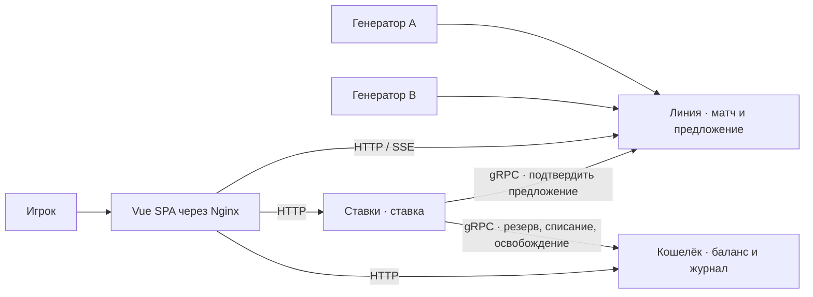

# Техническое задание. Мини-спортсбук

**Статус** — согласовано. Основа — [исходное задание](../../../test-task-description.md) и решения, принятые при обсуждении. [План реализации](../plans/2026-11-25-mini-sportsbook.md)

## Цель и объём

Один игрок открывает линию, видит изменения коэффициентов без перезагрузки, пополняет кошелёк условными деньгами и размещает ставку. Приложение показывает доступный баланс, условия ставки и результат её приёма. Весь стенд запускается командой `docker compose up`.

В объём входят три сервиса, клиентская SPA, тесты, Swagger UI и наблюдаемость. За рамками задачи — регистрация, платёжная интеграция, расчёт и выплаты по итогам матча, админка и SSR. Временные ограничения исходного задания исключены из планирования. README должен описывать запуск, устройство линии и ставки, вклад пользователя и ИИ, фактическое время и оставшиеся ограничения.

## Архитектура и границы DDD

Монорепозиторий содержит `services/line`, `services/bets`, `services/wallet`, `apps/web`, `contracts` и `infra`. Каждый Go-сервис запускается отдельным процессом. В сервисе бизнес-правила находятся в домене, сценарии и интерфейсы зависимостей — в прикладном слое, PostgreSQL и транспорт — в адаптерах. Сервисы обмениваются сообщениями контрактов и идентификаторами. У каждого сервиса своя БД и роль в одном экземпляре PostgreSQL. Между БД нет общих таблиц и внешних ключей.

| Сервис | Модель и владение данными | Публичный сценарий |
|---|---|---|
| Линия | Матч — корень агрегата, рынок 1X2 — сущность матча, исход и коэффициент — значения. Персональное предложение имеет собственный идентификатор и состояние подтверждения | Показ линии, поток обновлений, выдача предложения |
| Ставки | Ставка — корень агрегата. Хранит идентификаторы игрока и матча, исход, сумму, зафиксированный коэффициент и состояние обработки | Отправка ставки и чтение статуса |
| Кошелёк | Кошелёк — корень агрегата. Владеет балансом, резервами по `BetID` и журналом операций | Чтение баланса и условное пополнение |

Игрок представлен фиксированным серверным `PlayerID`. Режим рассчитан на локальный стенд с одним игроком. Браузер получает статику и API с одного origin через Nginx. Для gRPC используются Protobuf и grpc-go. Ставки вызывают Линию для подтверждения предложения и Кошелёк для управления резервом. Внутренние gRPC-порты доступны только в сети Compose.

Рассмотрены модульный монолит с общей транзакцией, разделение доменов на сервисы с прямым списанием и разделение на сервисы с резервированием. Выбран третий вариант. Кошелёк получает собственную границу и различает временное удержание средств и списание. Сервис ставок хранит состояние процесса и восстанавливает его после сбоя.

## Линия и предложение

Два независимых генератора с равным весом выдают наборы котировок П1, Х и П2 для общего каталога из 8 матчей. Для каждого источника сервис вычисляет обратные значения коэффициентов и нормализует их до суммы 1. Затем он усредняет вероятности по исходам, умножает их на 1,05 и переводит обратно в коэффициенты. Сумма обратных коэффициентов до округления равна 1,05. Сервис округляет опубликованный коэффициент до двух десятичных знаков. При пропуске данных источника сохраняет последний полный набор для матча до истечения срока свежести. При потере свежести закрывает приём предложений по этому рынку до восстановления обоих источников.

SSE отправляет полный снимок при подключении и переподключении, затем отправляет изменения. Подписка и отправка снимка обеспечивают порядок событий без пропуска обновления между ними. После разрыва SPA сохраняет последний снимок и показывает состояние соединения. После восстановления заменяет снимок актуальным. Если на первом подключении данных ещё нет, SPA показывает загрузку или ошибку.

1. При выборе исхода браузер запрашивает для игрока одноразовое предложение. Линия фиксирует `OfferID`, игрока, матч, исход, серверный коэффициент и время окончания действия `expiresAt = issuedAt + 60 секунд`. Форма показывает цену предложения и срок его действия. Для одной комбинации игрока, матча и исхода допускается одно активное предложение. Повтор запроса возвращает то же пригодное предложение без продления срока. При истечении срока или выходе цены за допуск Линия заменяет предложение актуальным и аннулирует прежнее. Выдача и замена упорядочены с подтверждением.
2. При подтверждении ставки браузер передаёт `OfferID`, сумму, отображённый коэффициент и ключ запроса. Линия проверяет предложение по серверным данным. Она проверяет владельца, совпадение коэффициента, открытость рынка, срок и разницу с актуальной опубликованной ценой. Условия действуют при времени первой серверной проверки строго раньше `expiresAt` и абсолютной разнице `≤ 1,00`. Пример границы — предложение `2,10` при текущем значении `3,10` допустимо, при `3,11` требуется новое предложение.
3. Линия атомарно сверяет текущую цену и записывает решение по `BetID`. Первое успешное подтверждение закрепляет предложение за этим `BetID`. Повтор того же вызова возвращает сохранённое решение и после окончания срока. Другой `BetID` не может использовать уже подтверждённое предложение. Изменение линии после подтверждения не меняет коэффициент ставки. Отклонённый запрос не создаёт резерв. Интерфейс получает новое предложение и требует отдельного подтверждения игрока.

## Кошелёк и жизненный цикл ставки

Суммы хранятся в целых минимальных единицах единственной условной валюты. Коэффициенты хранятся в сотых. API принимает суммы и отображаемый коэффициент десятичными строками. Сервер проверяет диапазон до преобразования и отклоняет ноль, отрицательные суммы и лишние дробные знаки. Кошелёк ведёт доступный и зарезервированный остатки. Изменение обоих остатков и запись в журнал выполняются в одной транзакции. Транзакция блокирует запись кошелька или выполняет эквивалентное атомарное изменение с проверкой остатков. Оба остатка всегда неотрицательны.

- **Пополнение.** Игрок вводит сумму и нажимает «Зачислить». Кошелёк увеличивает доступный остаток и возвращает результат операции. Ключ идемпотентности привязан к игроку, операции и сумме. Повтор сохраняет единственное зачисление. Использование того же ключа с другой суммой возвращает конфликт.
- **Приём ставки.** Ставки сначала сохраняют запись с уникальным ключом запроса игрока, исходными параметрами и статусом `pending`. Повтор с теми же параметрами возвращает ту же ставку. Если параметры отличаются, сервис возвращает конфликт. Затем Ставки получают решение Линии, сохраняют зафиксированный коэффициент, резервируют сумму в Кошельке по `BetID` и подтверждают списание. Ставка переходит в `accepted` после подтверждённого списания. Списание уменьшает зарезервированный остаток. Недостаток средств при резервировании или отказ Линии переводит ставку в `rejected`.
- **Освобождение и восстановление.** Кошелёк допускает переход резерва из `reserved` в одно конечное состояние — `captured` или `released`. Освобождение — внутренняя идемпотентная операция, которая возвращает сумму в доступный остаток. В пользовательском сценарии после успешного резерва Ставки автоматически переходят к списанию. Ставки сохраняют выбранное действие до вызова Кошелька. Сетевая ошибка оставляет ставку в обработке. Если запрос на списание мог пройти, Ставки повторяют списание с тем же `BetID` до получения результата. Фоновая обработка Ставок возобновляет сохранённый этап после перезапуска и сверяет результат через идемпотентные вызовы. Два обработчика не должны проводить противоречащие друг другу переходы.

После запроса на ставку SPA показывает текущий статус и обновляет его через HTTP до конечного результата. На неопределённый сетевой сбой интерфейс сохраняет ключ операции для повторной отправки. После изменения средств SPA повторно читает актуальный баланс.

## Контракты и фронтенд

Публичные HTTP/JSON операции версии `v1` — снимок линии, выдача предложения, создание и чтение ставки, получение баланса и пополнение. Для потока линии документируются типы событий, снимок и переподключение. Контракты публикуются как OpenAPI и доступны через Swagger UI на стенде. Для gRPC версионируются файлы `.proto`. Публичный API возвращает стабильные коды ошибки для просроченного предложения, выхода за допуск, закрытого рынка, недостатка средств и конфликта повторного запроса.

SPA использует Vue 3, TypeScript, Vite и Tailwind CSS. В FSD слой `app` инициализирует приложение, `pages` собирает экран, `features` реализует выбор исхода, ставку и пополнение, `entities` хранит модели линии, ставки и кошелька, `shared` даёт HTTP-клиент и общие элементы. Слайсы открывают публичные точки входа. Линт проверяет направление импорта и запрещает обход публичных точек входа. Состояние экрана организуется через Vue composables, обмен с API через `fetch` и `EventSource`.

## Наблюдаемость и отчёт сборки

- Prometheus собирает доступность, число и длительность HTTP- и gRPC-вызовов, подключения SSE, свежесть источников, возраст и число ставок в обработке, результаты резервирования и пополнения. Grafana получает настроенный источник данных и дашборд. Логи структурированы и связываются по `request_id` и `bet_id`. Идентификаторы остаются в логах и не используются как метки Prometheus.
- Полная команда сборки сначала компилирует SPA, затем поднимает стенд для измерения собранной версии. Lighthouse CI выполняет навигацию в Chromium с фиксированным профилем и детерминированными данными. Отчёт содержит FCP и LCP в миллисекундах. Скрипт отдельно считает размер начальных JS и CSS по графу входного manifest Vite, включая статические импорты и исключая дубликаты и чанки, загружаемые только динамически. Сохраняются байты и gzip-байты.
- Шаг сборки сохраняет машиночитаемый отчёт как артефакт и пишет запись в выделенную БД PostgreSQL с идентификатором сборки, ревизией, временем и профилем измерения. Повтор записи для той же сборки не создаёт дубликат. Ошибка измерения или записи завершает полный шаг сборки ошибкой. Локальный Compose хранит историю в постоянном томе. CI пишет в настроенную постоянную БД истории или в отдельную БД задания CI. Во втором случае отчёт из CI можно импортировать в постоянную БД тем же модулем загрузки. Grafana читает историю из постоянной БД через роль только для чтения и показывает FCP, LCP и размер бандла по сборкам.

## Проверки и критерии приёмки

Go использует `net/http`, `pgx`, `sqlc` и миграции Goose. Качество проверяют `gofmt`, `golangci-lint` с явно включёнными проверками ошибок, `govet` и `staticcheck`. Для фронтенда обязательны строгий TypeScript, отдельный `vue-tsc --noEmit`, ESLint с учётом типов и Prettier в режиме проверки. CI отклоняет сборку при любой ошибке или предупреждении линтера. Версии инструментов и зависимостей фиксируются в репозитории.

Разработка идёт по TDD. Модульные тесты используют Go `testing`, Vitest и Vue Test Utils. Интеграционные тесты работают с PostgreSQL через Testcontainers и проверяют публичные HTTP и внутренние gRPC-контракты, а также сценарии между сервисами. Playwright проверяет пользовательский поток на локальном стенде. Минимальные критерии:

1. Compose поднимает SPA, три сервиса, PostgreSQL, Prometheus и Grafana. Swagger UI открывает актуальный контракт.
2. Линия содержит 8 матчей с П1, Х и П2. Два источника влияют на опубликованную цену. Тест проверяет оверраунд до округления. SPA получает обновления и восстанавливает линию после разрыва SSE.
3. Корректное пополнение сразу отражается в балансе. Повтор запроса не зачисляет деньги второй раз. Невалидная сумма и конфликт ключа отклоняются.
4. Ставка с действующим предложением сохраняет исходную цену. Тесты покрывают порог `1,00` в обе стороны, превышение на `0,01`, момент истечения, закрытый рынок, подмену цены, параллельную выдачу предложений и повторное использование предложения.
5. При конкурирующих ставках на один остаток сумма принятых ставок не превышает доступные средства. Резерв переходит только в одно конечное состояние. Потеря ответа от Кошелька и перезапуск Ставок между списанием и записью статуса приводят к одной принятой ставке и одному списанию.
6. Повторное подключение к SSE, отказ в ставке и временная недоступность видны в интерфейсе. Полная сборка даёт отчёт с тремя метриками, запись в PostgreSQL и значения на дашборде Grafana.

## Порядок реализации и скиллы Superpowers

| Этап | Проверяемый результат | Скиллы |
|---|---|---|
| 1. Каркас | Монорепозиторий, Compose, правила импортов, форматирование, строгие проверки типов и CI | `writing-plans` после согласования ТЗ, затем `executing-plans` или `subagent-driven-development` по выбранному режиму |
| 2. Линия | Генераторы, расчёт, SSE и серверное подтверждение предложения | `test-driven-development`, `verification-before-completion` |
| 3. Кошелёк | Пополнение, резерв, списание и освобождение с тестами PostgreSQL | `test-driven-development`, `verification-before-completion` |
| 4. Ставки | gRPC-интеграция, восстановление процесса и Swagger UI для публичного API | `test-driven-development`, `requesting-code-review`, `verification-before-completion` |
| 5. SPA | Линия, форма ставки, пополнение и статусы с проверкой Playwright | `test-driven-development`, `verification-before-completion` |
| 6. Наблюдаемость и сдача | Метрики, отчёт сборки, дашборды, интеграционный прогон и README | `requesting-code-review`, `verification-before-completion` |

Все скиллы в таблице имеют префикс `superpowers:`. Для подготовки ТЗ использованы `using-superpowers` и `brainstorming`. При сбое применяется `systematic-debugging`, при обработке замечаний — `receiving-code-review`. Линия и Кошелёк могут разрабатываться параллельно после фиксации контрактов, если выбран параллельный режим. Тогда применяется `dispatching-parallel-agents`. При работе в отдельном checkout применяется `using-git-worktrees`. После успешных проверок `finishing-a-development-branch` применяется, если потребуется интеграция ветки.

## Решения, предложенные для первой версии

Для демо начальный баланс равен нулю, валюта имеет два дробных знака. Приём ставки запускается сразу после записи заявки, а интерфейс может получить промежуточный статус. Ограничение до одного активного предложения на игрока и исход защищает от накопления предложений по старой цене. Для замеров предлагается один мобильный профиль Chromium и медиана трёх запусков для каждой метрики. Отчёт служит базой сравнения сборок. Конкретные интервалы обновления, срок свежести источников и задержку повторов определяет детальный план.
